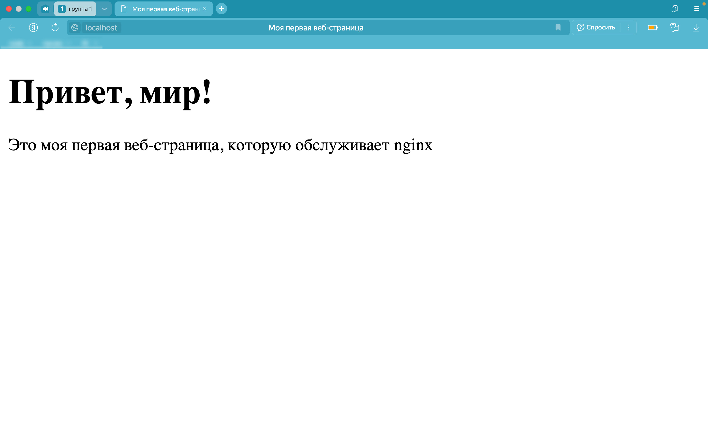

# nginx-guide: установка и настройка nginx на macOS с Homebrew (для локального тестирования)

## Содержание (Table of Contents)

- [Аннотация](#аннотация)
- [Предварительные требования](#предварительные-требования)
- [Системные требования](#системные-требования)
- [Полезные команды](#полезные-команды)
- [1. Подготовка системы и установка Homebrew](#1-подготовка-системы-и-установка-homebrew)
- [2. Установка и запуск nginx](#2-установка-и-запуск-nginx)
- [3. Настройка nginx](#3-настройка-nginx)
- [4. Создание HTML-файла](#4-создание-html-файла)
- [5. Просмотр веб-страницы](#5-просмотр-веб-страницы)
- [Устранение неполадок (Troubleshooting)](#устранение-неполадок-troubleshooting)

## Аннотация

Инструкция описывает безопасную установку и настройку веб-сервера **nginx** и запуска на нем веб-страницы с помощью менеджера пакетов **Homebrew** на системе **macOS 13.3** (Ventura) для локального тестирования. Инструкция предназначена для начинающих пользователей, которые изучают веб-технологии и хотят ознакомиться с **nginx**. 

**nginx** (engine x) — высокопроизводительный веб-сервер с открытым исходным кодом, который часто используется для обслуживания статических веб-страниц.

> [!IMPORTANT]
> **Ограничение ответственности (Disclaimer)**
> - Перед внесением изменений в конфигурацию сервера **обязательно создайте резервную копию** конфигурационного файла.
> - Не используйте эту конфигурацию в production‑среде без консультации с системным администратором.
> - Изменение системных настроек и работа с правами `sudo` несёт риски: при ошибках можно нарушить работу сервисов или потерять доступ к файлам.

## Предварительные требования

- Установленный **Homebrew**. Если его нет — см. раздел [1](#1-подготовка-системы-и-установка-homebrew).
- Базовое знание интерфейса командной строки (**Terminal**).
- Доступ администратора (права `sudo`) на компьютере.
- Текстовый редактор (рекомендуется **VS Code**, **TextEdit** или любой другой).

Перед началом работы рекомендуется ознакомиться с документацией:

- **nginx**:
  - [официальная документация;](https://nginx.org/en/docs/)
  - [руководство для начинающих.](https://nginx.org/ru/docs/beginners_guide.html)
- **Homebrew**: [Homebrew Docs.](https://docs.brew.sh/)

## Системные требования

**nginx** — легковесный веб-сервер, и его минимальные требования крайне невысоки. Ниже представлен минимальный набор для локальной разработки.

*Таблица 1. Системные требования*

| Компонент | Требования |
| --- | --- |
| macOS | 10.15 (Catalina) или новее |
| Процессор | Intel (x86_64) или Apple Silicon (ARM64) |
| Homebrew | 3.0.0 или новее |
| Свободное место на диске | ~50 МБ |
| Оперативная память | от 512 МБ (для комфортной работы с редактором и браузером — от 2 ГБ) |

> [!NOTE]
> nginx эффективно работает даже на старых Mac и на виртуальных машинах с 1 ядром.

## Полезные команды

Ниже представлены базовые команды **nginx**.

*Таблица 2. Управление сервером*

| Команда                       | Описание                                                 |
| ----------------------------- | -------------------------------------------------------- |
| `sudo nginx`                  | Запустить nginx (если не работает через `brew services`) |
| `sudo nginx -s stop`          | Остановить сервер                                        |
| `sudo nginx -s reload`        | Перезагрузить конфигурации *без* остановки сервера       |
| `sudo nginx -s reopen`        | Переоткрыть лог-файлов                                   |
| `brew services start nginx`   | Запустить через Homebrew (фоновый режим)                 |
| `brew services restart nginx` | Перезапустить через Homebrew                             |


*Таблица 3. Проверка конфигурации*

| Команда       | Описание                                                  |
| ------------- | --------------------------------------------------------- |
| `sudo nginx -t` | Проверить синтаксис конфига (обязательно перед `reload`!) |
| `sudo nginx -T` | Проверить синтаксис + вывести весь конфиг в терминал      |


*Таблица 4. Логи и отладка*

| Команда                                          | Описание                                    |
| ------------------------------------------------ | ------------------------------------------- |
| `tail -f /opt/homebrew/var/log/nginx/access.log` | Просмотреть логи доступа в реальном времени |
| `tail -f /opt/homebrew/var/log/nginx/error.log`  | Просмотреть ошибки в реальном времени       |
| `sudo lsof -i :80`                               | Проверить, какой процесс использует порт 80 |


*Таблица 5. Работа с файлами*

| Команда                                        | Описание                                   |
| ---------------------------------------------- | ------------------------------------------ |
| `sudo code /opt/homebrew/etc/nginx/nginx.conf` | Открыть конфиг в VS Code                   |
| `sudo cp nginx.conf nginx.conf.backup`         | Создать резервную копию конфига            |
| `sudo diff nginx.conf nginx.conf.backup`       | Сравнить текущий конфиг с резервной копией |

> [!NOTE]
> Эти команды решают повседневные задачи. Для продвинутых сценариев (например, настройка SSL, балансировки нагрузки) см.
> [официальную документацию nginx](https://nginx.org/en/docs/)

## 1. Подготовка системы и установка Homebrew

**Homebrew** — утилита командной строки для установки пакетов и приложений в macOS. 

Если Homebrew ещё не установлен:

1.  Откройте **Терминал** и вставьте команду c официального сайта [brew.sh](https://brew.sh/ru/):

    ```bash
    /bin/bash -c "$(curl -fsSL https://raw.githubusercontent.com/Homebrew/install/HEAD/install.sh)"
    ```

2.  Введите пароль администратора для подтверждения (ввод пароля *не* отображается).

> [!IMPORTANT]
> Во время установки Homebrew запрашивается пароль администратора (sudo), так как требуются права `root` для установки в
> системные директории. Вводите пароль только при уверенности в источнике скрипта.

3.  Нажмите **Return** и дождитесь завершения установки (может занять несколько минут). Появится строка `Installation successful`!

4.  Убедитесь в корректности установки через команду проверки версии:

    ```bash
    brew --version
    ```

## 2. Установка и запуск nginx

Чтобы установить **nginx** с помощью **Homebrew**:

1.  Откройте **Терминал** и введите команду:

    ```bash
    brew install nginx
    ```

2.  Дождитесь завершения. Homebrew автоматически установит все зависимости.

3.  Запустите сервер:

    ```bash
    brew services start nginx
    ```

4.  Проверьте статус (должно быть `started`):

    ```bash
    brew services list
    ```

5.  Для проверки работоспособности перейдите по адресу в браузере: `http://localhost:8080/`.

> [!NOTE]
> Порт `8080` используется по умолчанию для избежания конфликтов с другими сервисами и чтобы не требовать постоянных
> прав суперпользователя.

## 3. Настройка nginx

### 3.1. Создание рабочей директории

Создайте корневую папку для файлов сайта, например, на рабочем столе:

```bash
mkdir -p ~/Desktop/mywebsite
```

Запомните этот путь — он понадобится для настройки `root` в конфигурации **nginx**.

### 3.2. Поиск конфигурационного файла

Точный путь к конфигурационному файлу можно узнать командой:

```bash
brew info nginx
```

В выводе ищите строку вида: `Configuration files are at: /opt/homebrew/etc/nginx`.

Обычно файл находится по пути: `/opt/homebrew/etc/nginx/nginx.conf`.

> [!WARNING]
> Путь может отличаться в зависимости от конфигурации **Homebrew**. Всегда проверяйте его через `brew info nginx`.

### 3.3. Создание резервной копии конфигурации

Перед любыми правками обязательно создайте резервную копию:

```bash
sudo cp /opt/homebrew/etc/nginx/nginx.conf /opt/homebrew/etc/nginx/nginx.conf.backup
```

Это позволит быстро восстановить рабочую конфигурацию при ошибках.

### 3.4. Редактирование конфигурации

Откройте конфигурационный файл в текстовом редакторе (пример для **VS Code**):

```bash
sudo code /opt/homebrew/etc/nginx/nginx.conf
```
> [!IMPORTANT]
> При редактировании конфигураций с `sudo` будьте внимательны: ошибки могут остановить сервер.

Внутри файла найдите блок `server { ... }`. В нём нужно изменить два параметра:

- `listen`: по умолчанию стоит `8080`; если вы хотите оставить этот порт, ничего не меняйте. Если хотите использовать порт `80`, измените на `listen 80;`;

> [!IMPORTANT]
> Порт `80` требует прав суперпользователя и может конфликтовать с другими сервисами. Для обучения лучше оставить `8080`.

- `root`: по умолчанию часто стоит путь к тестовой директории **Homebrew**. Замените его на вашу рабочую директорию:

```bash
root /Users/ВАШ_ПОЛЬЗОВАТЕЛЬ/Desktop/mywebsite;
```

Где `ВАШ_ПОЛЬЗОВАТЕЛЬ` — ваше имя пользователя macOS (узнать можно командой `whoami`).

Пример изменённого блока `server` (с портом `8080`):

```bash
server {
    listen 8080;
    server_name localhost;

    root /Users/ВАШ_ПОЛЬЗОВАТЕЛЬ/Desktop/mywebsite;
    index index.html;

    location / {
        try_files $uri $uri/ =404;
    }
}
```

Сохраните файл и закройте редактор.

### 3.5. Проверка синтаксиса конфигурации

Перед перезагрузкой обязательно проверьте синтаксис:

```bash
sudo nginx -t
```

Если вывод содержит `syntax is ok` и `test is successful`, конфигурация корректна. Если есть ошибки — исправьте их и повторите проверку.

Перезагрузите конфигурацию без остановки сервера:

```bash
sudo nginx -s reload
```

## 4. Создание HTML-файла

Чтобы **nginx** отображал страницу, в корневой директории должен быть файл `index.html`.

1. Создайте файл:

   ```bash
   touch ~/Desktop/mywebsite/index.html
   ```

2. Откройте его в редакторе и вставьте базовый HTML‑код:
  
   ```html
   <!DOCTYPE html>
   <html>
   <head>
       <meta charset="UTF-8">
       <title>Моя первая веб-страница</title>
   </head>
   <body>
       <h1>Привет, мир!</h1>
       <p>Это моя первая веб-страница, которую обслуживает nginx!</p>
   </body>
   </html>
   ```

3. Сохраните файл.

4. Убедитесь, что файл существует в нужной директории:

   ```bash
   ls -l ~/Desktop/mywebsite/
   ```

## 5. Просмотр веб-страницы

Откройте браузер и перейдите по адресу:

- если вы оставили порт `8080`: http://localhost:8080/;
- если вы изменили на порт `80`: http://localhost/.

Вы должны увидеть страницу с заголовком **Привет, мир!**, как на рисунке ниже.



*Рисунок 1. Успешный просмотр веб-страницы в браузере*

## Устранение неполадок (Troubleshooting)

### Не запускается nginx

**Симптомы**: 

- команда `brew services start nginx` завершается ошибкой;
- при переходе на `http://localhost` страница не загружается.

**Решение**:

1. Проверить статус **nginx**:

```
brew services list
```

2. Если статус не `started`, выполнить:

```
brew services restart nginx
```

### Ошибки в конфигурации

**Симптомы**: 

- после `sudo nginx -t` появляются сообщения о синтаксических ошибках;
- **nginx** перестает отвечать после `reload`.

**Решение**:

1. Проверить синтаксис командой:

```
sudo nginx -t
```

2. Если ошибка указывает на строку (например, `line 25`), открыть конфиг:

```
sudo code /opt/homebrew/etc/nginx/nginx.conf
```

3. Убедиться, что все `{ }` и `;` на месте.

4. Проверить корректность пути (например, `/Users/username/Desktop/mywebsite`).

5. Восстановить рабочую версию конфига из резервной копии:

```
sudo cp /opt/homebrew/etc/nginx/nginx.conf.backup /opt/homebrew/etc/nginx/nginx.conf
```

### Страница отображается некорректно

**Симптомы:** в браузере отображаются символы вместо текста.

**Решение:**

1. Проверить кодировку HTML-файла:
    - Открыть `index.html` в **VS Code**
    - В правом нижнем углу кликнуть на кодировку (должно быть: **UTF-8**).
    - Если указана другая, то нажать **Save with Encoding** → **UTF-8**.

2. Проверить наличие мета-тега **<mеta charset="UTF-8">** в **<hеad>**.